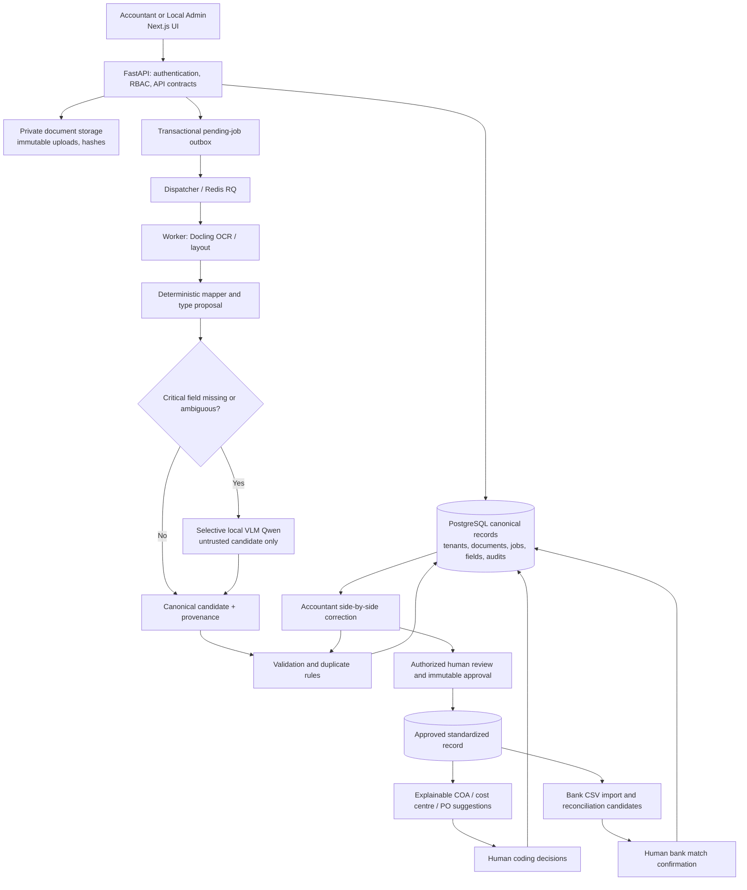

# COS40005 Group 14 — Accounting Intelligence V2: Product and System Architecture

**Status:** Proposed target design; not a statement that all functions exist. **Baseline:** team `features` branches inspected on 18 Oct 2026; see `CURRENT_BASELINE_V2.md`. **Audience:** Codex, developer teammates, SAIC, supervisors. **Source of scope:** approved Group 14 Team and Project Plan, P0/P1/P2 section; detailed October 18 gap audit. **Review gate:** schema/workflow decisions need owners and client agreement.

> **Product promise:** Reduce accountant time spent collecting, typing, checking, categorizing, looking up, reconciling and explaining financial records **while preserving source evidence, financial precision, access controls and human accountability**. AI is a traceable assistant, not an autonomous bookkeeper.

## 1. Strict scope contract

| Scope | Required capability | Definition of real completion |
|---|---|---|
| **P0 Core** | PDF and image ingestion; batch intake; async processing; document type detection; invoice/bill/receipt header and line item extraction; canonical normalization; vendor/entity matching; monetary arithmetic; duplicates; field-level confidence/evidence; human exception/review/correction; approved immutable records; JSON/CSV/XLSX; audit | A freshly uploaded (not seeded) synthetic document progresses through real worker, PostgreSQL, rules, review and authorized export; negative cases block or require review |
| **P1 Intelligence** | Tenant COA and GL/account-category suggestions, cost-centre suggestions, persistent PO matching, bank CSV import, Money-In/Out from bank entries, invoice-to-bank candidates, reconciliation workspace, grounded accountant operations dashboard | Recommendations have reasons/source, reviewed decisions are persisted and tenant-scoped, and bank entries are actually matched without making payments |
| **P2 Research/stretch** | Goods receipt/three-way matching, anomaly detection, correction-informed learning, richer AR workflow, bounded natural-language accounting assistant | Only after P0+P1 gates and privacy/quality evaluation; no open-ended authority |
| **Out of scope** | Live Xero/SAP integration; real bank API or money movement; tax filing/statutory tax calculation; authoritative auditing/certification; full ERP/general ledger/replacement for bookkeeping | Do not sneak in side effects or imply these exist |

**“Solve most accountant problems” is an aspiration, not an implemented claim:** focus on the high-friction **document-to-approved-record** and **record-to-supported-bank-match** operations, not every accounting discipline. Capture accountant interviews/requirements and adjust prioritized tasks, not scope creep.

## 2. User problems → workflow capabilities

| Accountant problem | Product action | Evidence/controls |
|---|---|---|
| Entering supplier/customer PDFs and receipts manually | Drop/upload multi-file; OCR+layout+structured extraction | Original file hash, page boxes, model/parser version, raw output |
| Sorting mixed inbox documents | Suggest kind and AP/AR; detect ambiguous/unknown | Rule/prompt evidence; editable confirmation; correction reason |
| Repetitive review of numbers and lines | Side-by-side source + extracted fields; focus errors first; bulk actions only safe operations | Immutable raw vs editable current, field revisions and audit |
| Incorrect totals, tax, currencies and vendor names | Deterministic `Decimal` rules, vendor alias resolution and exception priority | Explain exact equation/difference and source values; no silent fixes |
| Duplicate supplier invoices | Tenant-scoped exact hash and business-key duplicate detection | Block and show reasons, authorized audited override |
| Determining expense/revenue accounts | Explainable suggestions for tenant GL codes and cost centres | Candidate rules, vendor context, evidence and human confirmation; no journal posting |
| Matching invoices with purchase orders | Persisted PO header/line matching; review price/qty/date/vendor variances | PO version, discrepancy details and reviewer decision |
| Sorting bank activity and finding paid/outstanding | Import normalized **bank CSV**; classify actual debit/credit; rank invoice matches | Bank row provenance, one-to-one allocation checks, reviewer confirmation |
| Chasing review queues and reporting | Real queue, SLA/aging, exceptions and measured activity dashboards | Server counts, audit records, actual processing timings; no false accuracy |
| Explaining a number to supervisor/client | Evidence-citing answer/trace screen (P2) | Clickable source, queries and as-of date; read-only and uncertain when data absent |

## 3. Logical architecture and responsibilities



**One source of truth:** the backend and database; Next.js only presents and submits intentions. Worker messages pass opaque IDs, not financial payloads. AI returns **candidates plus evidence**; business rules and human users decide. On startup, avoid non-reviewed schema mutation; use controlled, versioned migrations, not a shared production database.

### Deployment separation
- **Browser / Next.js:** UI on `localhost:3000` for local testing or approved HTTPS frontend in staging.
- **FastAPI:** independent HTTPS service for authenticated routes and app health; Next.js same-origin proxy, correct cookie/CSRF origins.
- **Storage:** tenant-owned private filesystem for isolated laptop demo; persistent object storage with server authorization and verified hashes for staging (not Vercel ephemeral filesystem).
- **PostgreSQL:** tenant-aware canonical records, append-only audit, transactional outbox, migrations and backups.
- **Redis/RQ:** queue broker/workers; output minimal metadata; never use Redis as canonical database. CPU Docling may be large; background worker must have appropriately provisioned RAM/CPU.
- **Optional local vision model:** Qwen2.5-VL or evaluated successor, only with approved local or data-governed inference; replaceable provider adapter. Run selectively to reduce latency and hallucination.
- **Telemetry:** structured events/status/duration/job identifiers, no passwords/OTP/PDF contents in logs; staging dashboards explicitly separate from production claims.

## 4. Canonical domain model: independent axes (non-negotiable)

### 4.1 Document kind (what is the file?)
`invoice`, `bill`, `receipt`, `credit_note`, `debit_note`, `unknown/other` (unknown can remain in classification proposal until schema supports). Labels must be source-grounded and auditable. An invoice is not inherently AP: an issued invoice can be AR, a received invoice AP.

### 4.2 Business category (why does tenant hold it?)
`accounts_payable` / `accounts_receivable` / explicit not-applicable or undetermined for certain cash receipt/refund use cases **only after schema/owner review**. Track seller/buyer roles, tenant party identity and origin. Never infer AR/AP solely from filename, negative/positive amount or PDF title.

### 4.3 Workflow statuses (independent)
- **Ingestion/extraction:** uploaded, queued, processing, extracted, failed (exact existing vocabulary must be mapped and preserved).
- **Validation/review:** needs_review, exceptions/open, corrected, validated, submitted, approved/rejected.
- **Record:** draft candidate, standardised immutable, amended through revision/supersession rather than changing history.
- **Accounting coding:** suggested, confirmed/overridden, awaiting coding; confirmed codes are **not posted journal entries**.
- **Settlement/reconciliation:** unmatched, proposed, matched/confirmed, disputed, partial (future), bank-evidenced; invoice approval alone **does not mean paid**.

### 4.4 Bank cash direction
A normalized **bank debit** → Money-Out; **bank credit** → Money-In (bank statement's account perspective, sign conventions explicitly mapped). A receipt/PDF/invoice/credit note cannot establish bank settlement by itself. A match is evidence of an observed bank transaction, not payment initiation.

### 4.5 Example truth table

| Source | Kind | AP/AR | GL proposal | Bank status |
|---|---|---|---|---|
| Supplier stationery invoice | Invoice | AP | Office supplies expense or inventory depending on policy | Outstanding unless actual debit evidence |
| Vendor utilities statement | Bill | AP | Utilities | Outstanding until confirmed debit |
| Our sales invoice to customer | Invoice | AR | Sales revenue | Outstanding until confirmed credit |
| Card retail receipt | Receipt | Context-specific expense | Office supplies | Payment method stated, bank proof not assumed |
| Supplier credit note | Credit note | Adjusts AP context | Related purchase account | Credit note is **not bank Money-In** |
| Bank statement outgoing transfer | Bank entry | Not an invoice/AP document | Potential bill settlement | Actual Money-Out; confirm candidate record |
| Bank statement incoming transfer | Bank entry | Not AR document | Potential customer settlement | Actual Money-In; confirm candidate record |

## 5. Pipeline design: from upload to approved record

1. **Intake/auth:** authenticate tenant and role; select files; enforce allowed formats, size/camera orientation when supported. Browser can propose kind/category but stores it as **user hint**, not ground truth. Use SHA256 + idempotency key, tenant file isolation. Create DB document and pending job atomically.
2. **Dispatch and worker:** queue from persisted outbox only. Claim/lease a job, record states, attempts and heartbeat; prevent duplicate processing on retry/race; recover after Redis/worker outage. Don't consider `enqueue()` success equivalent to extraction success.
3. **Docling-first parse:** actual OCR/layout with page numbers, line structure/tables, reading order; save raw structured output and source hash, parser/model versions and duration.
4. **Classification candidate:** detect supported kind with evidence (headings/layout/party context). Unknown on ambiguity. Preserve user-selected kind independently; explicit review of conflicting classes.
5. **Deterministic mapping:** extract typed common fields + kind-specific fields, line items, bounding boxes/snippets when available, and distinguish `raw_value`, `normalized_value`, `current_value`, extraction state/method.
6. **Selective vision fallback:** only when critical value missing/ambiguous, OCR insufficient or layout materially broken. Crop referenced region or bounded page; use field-specific schema; reject unsupported/uncited candidates. Limit calls by latency/token budget; model never fills unknown totals with guesses.
7. **Validation:** per-kind required fields, currency/ISO date, exact `Decimal` math, supplier/customer candidate resolution, duplicates (hash and normalized supplier+invoice), mismatch exceptions. Persist provenance and reason codes.
8. **Queue/UX:** list the real document even while processing. Show meaningful status/duration, no fake 0 sec. If a failed worker or retrieval error, show retryable failure without pretending a completed record exists.
9. **Review:** original file pinned beside fields/lines and source evidence, save corrections with actor/reason/revision; revalidation invalidates older verdict; no stale approval.
10. **Approval/snapshot:** proper role/approval gates; block unresolved severe exceptions and duplicate except authorized reasoned override; capture an immutable normalized snapshot, exact currency/financial numbers, source provenance, validated revision and approvals. Do not mutate previous snapshot.
11. **Export:** tenant-scoped approved records only; JSON/CSV/XLSX with stable schema version, nullability, decimal strings and spreadsheet injection safety; record as-of snapshot and audited download. No claim of ERP-compatible format without actual specification.

## 6. Planned data entities and boundaries

**Existing team schema (inspected in `features`):** tenants, users and sessions, documents, pending_jobs, raw_extractions, field_predictions, field_corrections, line_items and line_item_corrections, exceptions, vendors/customers, standardised_records, record_amendments, validation_rules, review_submissions/decisions, audit_logs, report/export and notification tables, document_reconciliations (document-to-document), metadata/workload/permissions tables. Always inspect current DDL before design—schema changes since 2026-10-18 may exist.

**Proposed P0 evolution** (after owner review): structured doc-kind decisions and overrides with confidence/evidence; vendor aliases and confirmed party links; type-specific normalized fields; page-level evidence references; service/model versions; safe revision tokens; document link to exact approved snapshot. Reuse existing tables/fields whenever possible.

**Proposed P1 additions** (NOT in inspected baseline DDL): tenant `coa_accounts`, `cost_centres`, confirmed coding decisions, purchase_orders/order_lines, po_match_reviews, bank_imports, bank_accounts or anonymized account references, bank_transactions, reconciliation_candidates/decisions and supporting allocations. Preserve tenant ID/FK/scoped unique keys/audit/version; ledger postings are explicitly excluded.

**Important naming collision:** `services/extraction/reconcile_selective.py` describes parser vs Qwen field reconciliation; backend `document_reconciliations` is document/credit-note linkage. **Neither is bank reconciliation.** Never reuse these names/API behavior as proof of bank matching.

### Invariants
- Every financial row belongs to one tenant; a foreign tenant request returns 404/denied.
- Record IDs and `REC-*` codes originate from DB, not synthesized in UI.
- Missing fields are `null`/unresolved, never `0` or fake `100% confidence`.
- A source document's hash/path is verified before preview/worker access.
- An approved snapshot is immutable or superseded with explicit revision; source extraction isn't rewritten to fabricate history.
- Monetary operations are decimal-exact and currency-aware; no implicit cross-currency matching.
- Bank row uniqueness and confirmed-match allocations prevent double reconciliation; ambiguous/partial matches require explicit policy.

## 7. Intelligence tiers: maximize usefulness without sacrificing trust

| Tier | Technique | When used | Authority |
|---|---|---|---|
| 0 | Deterministic parsers, OCR/layout, regex, decimals, validated schema | Every document | Data candidate, never automatic accounting conclusion |
| 1 | Context/entity resolution, vendor/party aliases, keyword/embedding retrieval | Missing names, GL/PO candidates | Ranked explanation, reviewable |
| 2 | Selective VLM (Qwen2.5-VL) with bounded prompt and source crop | Only unresolved/ambiguous critical fields | Untrusted candidate; needs verification |
| 3 | Rule engine + constrained accounting reasoning | Category/GL/cost-centre/PO/bank candidate proposal | No posting, no approval; human confirms |
| 4 (P2) | Retrieval-grounded accountant assistant: answer “Why flagged?”, “What is outstanding?”, “Show matches” | Read-only queries with access-controlled indexed sources | Cite exact doc/record/transaction; abstain if unsupported, no automatic mutation |

**Not an “agent that clicks approve”.** If future tools are added for assistants, default to read-only typed query tools, audited scoped access, no direct arbitrary SQL, no exporting raw customer data to unauthorized LLMs. Any write requires deliberate user action, backend policy, and preferably deterministic UI confirmation.

## 8. Accountant workspace information architecture

```
Workspace
  Overview                 real queue, failures, review aging, measured processing
  Inbox & Documents        intake, batch, filter, status, ownership, source viewer
  Review & Exceptions      validation findings, action-required queue, field/line corrections
  Standardised Records     approved snapshot, version/audit, true category, JSON/CSV/XLSX
  Accounting Coding [P1]  GL/cost centre candidates, reasons, accept/override
  Purchase Orders [P1]    reference PO import, matching, discrepancies
  Bank Imports [P1]       bank CSV mapping, normalized debit/credit, import review
  Reconciliation [P1]     unmatched ledger *reference records* vs bank rows; proposals & decisions
  Reports & Audit         real operational metrics, event history, traceability
  My Profile              secure identity, MFA, permissions
Company administration    users, approvers, vendors, COA, cost centres, rules
Platform administration   tenants, access/health; gated support view + audit
```

A good accountant can upload → see evidence → edit → understand exception → revalidate → submit → get approval → export without hunting through unrelated admin pages. Reserve consistent semantics, prominent statuses, keyboard shortcuts where safe, batch triage, sticky actions, “next pending” navigation, confidence `unavailable` state, and preview that survives tab changes. Keep UI responsive and accessible; do not force a redesign of Angeline's brand unnecessarily.

## 9. Explicit nonfunctional requirements

**Security:** httpOnly secure cookies/CSRF/auth, strict tenant filtering; audit every financial correction/override; private storage; no OTP or PDF in logs; upload checks and signed/authorized file access; read-only support view with stated reason. No external LLM transmission of financial data absent approval/data policy. Scan dependencies/security advisories without arbitrary major upgrades.

**Durability:** transactional outbox, job leases, idempotent worker/approval, recovery after restart; protect DB from partial writes; explicit retry count/terminal failure; preserve evidence with versioned transforms.

**Financial fidelity:** exact values, negative/refunds, tax-inclusive/exclusive policy, mixed tax rates and discounts; preserve ambiguous values. Locale/timezones distinct from document issue and bank-post dates. Currency conversion only with explicit evidenced FX source/rate/date, otherwise no cross-currency auto-match.

**Observability:** job stage elapsed and queue elapsed (p50/p95), documents/status by tenant, exception age, correction counts, export event, DB/worker health. Distinguish parser quality from infrastructure success.

**Performance:** synchronous API for metadata; background jobs for OCR/AI; bounded worker concurrency and CPU/RAM, timeouts, thumbnail caching, lazy page loading, API pagination; measure on actual hardware and dataset. No invented SLA or accuracy target.

**Testing:** isolated per-module unit/contract, real DB/RQ/Docling integration, Playwright UI acceptance with real cookies/MFA, tenant/security negatives, robustness under job crash and worker restart, labeled extraction evaluations. Never make broad production claims from isolated mocks or a Vercel landing page.

## 10. Roles and approval gates

| Role | Responsible domain | Changes needing review |
|---|---|---|
| Rachel / Module 1 | FastAPI, auth, file ingestion, orchestration/API | New endpoints, request semantics, deployment/queue wiring |
| Jonathan / Module 2 | Docling/OCR, classification, selective VLM, evidence, evaluation | AI output contracts, parser assets, prompts/model policy |
| Aina / Module 3 | Deterministic validation, duplicate/PO/bank matching rules, QA | Required fields, arithmetic tolerance, blocking exceptions, ranking |
| Aleeya / Module 4 | Canonical models, migrations, storage, aliases/COA/bank persistence | Every schema migration and immutable record contract |
| Angeline / Module 5 | User-facing Next.js accountant workflow, UX/a11y/tests | Layout changes, new navigation, correction/coding UX |
| SAIC/supervisors | Accounting problem prioritization and policy | Which P1 features are in current milestone; account taxonomy, approval rules, privacy |

Cross-module implementation is allowed, but ask owners to review cross-boundary changes. Never infer that a branch contains client-approved decisions. Keep concise ADRs in `docs/decisions/` when a product decision is accepted.

## 11. Delivery philosophy
- **Vertical slices** with explicit evidence and owner review, not dozens of unconnected screens/routes.
- **No fake intelligence:** a correct abstention is preferable to a convincing wrong total.
- **Small scoped Codex turns:** inspect 3–10 relevant files, plan change, implement, test, report. Don't feed 70k-line logs or every PDF into the context; refer by path and grep relevant ranges.
- **Source-of-truth preservation:** team `features` remains untouched until approved review/PR. Dev branches named `feature/accounting-v2` in two independent repositories.
- **Go/no-go:** roadmap exit gates in `DELIVERY_ROADMAP_V2.md` and precise schema/API policies in `DOMAIN_AND_API_CONTRACTS_V2.md`.

## 12. Definition of “intelligent enough”
For an unseen document, the system can determine that it doesn't know; extract verifiable fields and line items with provenance; surface exact exceptions; suggest a well-supported accounting code; associate an imported PO or bank transaction with reasons; invite a human decision; preserve corrections and immutable outputs; and prove improvement with held-out evaluation. A system that returns plausible answers without original evidence is **not** intelligent accounting automation.
