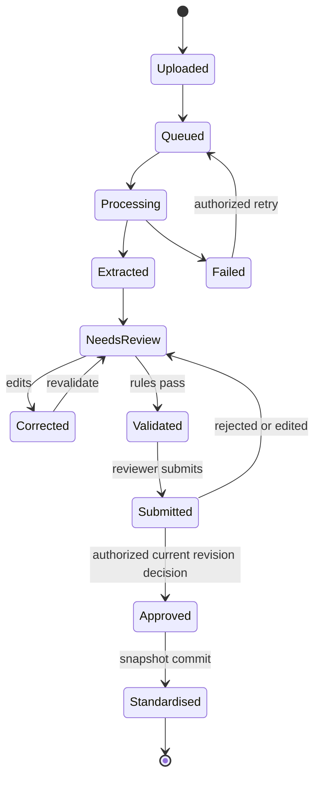

# Domain Model, API & Accounting Contracts (V2)

**Status:** Working design contract. “Observed” endpoint paths are from backend `features` code at SHA `4c4a030` on 18 October 2026; proposed endpoints/types are explicitly **not implemented**. Always inspect actual current `app.py` and `src/lib/api` before coding. Rachel/Aleeya/Aina must approve cross-module API/schema/validation decisions.

## 1. Contract evolution guidelines

- Keep backend response types explicit and versionable. Preserve existing frontend camelCase DTOs only when required by current deployed clients; use type adapters at module boundary rather than inconsistent stored column names.
- All IDs stable UUIDs, public `documentCode`/`recordCode` from DB, not derived from random frontend substrings. Enum case conversion explicit, never ad hoc defaults.
- Money as exact decimal **strings** (`"2650.00"`, `"-23.45"`) in financial endpoints, postgres `NUMERIC`, Python `Decimal`, safe TypeScript decimal display. Do not calculate via `Number`/float when precision matters. Quantities may also be decimal strings. Null remains null.
- Dates: original business `date` is `YYYY-MM-DD`; UTC event timestamp is ISO 8601 with offset; do not substitute ingestion time for invoice date. Human local rendering uses chosen tenant timezone, preserving original source date.
- Every mutation with material financial consequences should use idempotency token and/or expected content revision, audit actor/reason and return stable outcome; rejected outdated revisions return `409 Conflict` with no partial update.
- Return 401 unauthenticated, 403 unauthorized same-tenant role, 404 unknown/other-tenant record without distinguishing existence, 409 version conflict/duplicate (policy-specific), 422 invalid business input, 5xx for infrastructure; document expected errors. Actual existing endpoints may differ; changes need backward compatibility.
- `pending`, `unknown`, `null`, `not_measureable`, `needs_review` are legitimate states and should not be displayed as zero, approved or completed.
- For list APIs use stable ordering, server-side pagination, total count, consistent filters and tenant scoping; no N+1 synthesis of approved records from document list.

## 2. Existing `features` endpoint inventory (SOURCE-OBSERVED, runtime UNVERIFIED)

| Area | Observed routes | Caveat |
|---|---|---|
| Auth | POST `/api/auth/login`, POST `/api/auth/verify-mfa`, POST `/api/auth/refresh`, GET `/api/auth/me`, logout, activation, password/reset | Session/role policy in backend; protect cookies/CSRF |
| Ingestion | POST `/api/documents`; GET `/api/documents`, GET `/api/documents/{id}`, GET `/api/documents/{id}/file`, POST `/api/documents/{id}/retry` | Upload contract differs from old integration's `/api/documents/upload` |
| Extraction & review | GET `/api/documents/{id}/extraction`, PATCH `/api/documents/{id}/extraction/{field_key}`, PATCH `/api/documents/{id}/line-items/{line_item_id}/{field_key}`, POST `/api/documents/{id}/revalidate`; reviews/decision/comments | Must verify persisted current revision and review gates |
| Exceptions | GET `/api/exceptions`, PATCH `/api/exceptions/{id}/resolve` and `/assign`; validation rules | Counts & blocking severity need negative tests |
| Records | GET `/api/records`, GET `/api/records/{id}`, `/metadata`, POST `/api/records/from-document/{id}`, amendment/support-view APIs | Actual standardisation uses local admin decision gate and stores immutable/versions per schema; evaluate null/decimal behavior |
| Reports | GET `/api/reports/accounting`, `/api/processing/metrics`, `/api/processing/trends`, `/api/audit`, exports + XLSX | Names/metrics may be misleading; export materialization needs review |
| Other | `/api/users`, `/api/tenants`, `/api/processing/jobs*`, suppliers/customers, tags, reminders, workload, batches, notifications, document versions, permissions | Existence not proof of complete UX |

**Not equivalent endpoints:** old backend `/api/documents/upload`, `/api/documents/{id}/result`, `/api/documents/{id}/fields/{key}`, `/api/documents/{id}/approve` and `/api/records` Sprint A.1 adapters belong to the old integration branch unless separately implemented here. Do NOT copy frontend code that assumes them.

## 3. Proposed canonical domain schemas (planning examples only)

### Document

```json
{
  "id": "uuid",
  "tenantId": "uuid",
  "documentCode": "INVOICE_100001",
  "sourceHashSha256": "hex64",
  "kindSelectedByUser": "invoice|null",
  "kindDetected": "invoice|bill|receipt|credit_note|debit_note|unknown",
  "kindReviewed": "invoice|null",
  "category": "accounts_payable|accounts_receivable|undetermined",
  "ingestionStatus": "queued|processing|extracted|failed",
  "validationStatus": "needs_review|validated|exceptions",
  "approvalStatus": "not_submitted|submitted|approved|rejected",
  "contentRevision": 3,
  "approvedRecordId": null,
  "processingSeconds": null,
  "uploadedAt": "2026-10-18T12:00:00+00:00"
}
```

Do not unilaterally add these columns/enums; preserve existing `documents.kind/status/category` until owner-approved versioned migration/adapter. Never introduce an `undetermined` enum if DB check does not permit it; store an unknown proposal elsewhere until schema supports.

### Extraction run

```json
{
  "id": "uuid",
  "documentId": "uuid",
  "sourceHash": "hex64",
  "runNumber": 1,
  "parserVersion": "docling-x.y",
  "modelVersion": null,
  "method": "DOCLING|DOCLING_PLUS_SELECTIVE_VLM",
  "status": "extracted|partial|failed",
  "startedAt": "2026-10-18T12:00:10Z",
  "completedAt": "2026-10-18T12:00:24Z",
  "fields": [],
  "lineItems": [],
  "warnings": []
}
```

### Field/provenance and line item
See `AI_ENGINE_V2.md` field object. Every money field has `value=null|string`, source/hash and available evidence; parser confidence `null` is allowed. Items have `id`, `lineNumber`, `description`, `quantity`, `unitPrice`, `amount` as decimal strings or null, source page/bbox, original/reviewed state.

### Approved record

```json
{
  "id": "database-uuid",
  "recordCode": "REC-10070",
  "tenantId": "uuid",
  "documentId": "uuid",
  "sourceRunId": "uuid",
  "approvedContentRevision": 3,
  "category": "accounts_payable",
  "currency": "MYR",
  "subtotal": "2500.00",
  "discount": "0.00",
  "taxAmount": "150.00",
  "totalAmount": "2650.00",
  "lineItems": [{"lineNumber":1,"quantity":"10","unitPrice":"250.00","amount":"2500.00"}],
  "approvedBy": "uuid",
  "approvedAt": "2026-10-18T12:04:10+00:00",
  "snapshotVersion": 1,
  "sourceHash": "hex64",
  "status": "standardised",
  "paymentStatus": "unverified"
}
```

Do not introduce `paymentStatus` as a blanket approved-record field without actual bank-link contract. Existing snapshot representation must be analyzed and migrated/serialized safely. Approval proves review, not bank settlement.

## 4. Proposed P0 API adjustments and acceptance

| API change (proposed) | Meaning | Acceptance before exposing UI |
|---|---|---|
| `GET /api/documents/{id}/evidence` | Return current source-backed page/block refs and field lineage | Authorization, hash+page match, no fabricated boxes, source unavailable explicit |
| `GET /api/documents/{id}/classification` | Detected kind/category proposals, evidence, conflicts | Unknown returned honestly; selected vs detected distinction |
| `PATCH /api/documents/{id}/classification` | Human type/category decision with reason and revision | Role, optimistic lock, logs, new validation required |
| `GET /api/documents/{id}/review-context` | Consolidated source, candidates, review/exception/coding status | No N+1 or data leakage; exact source/revision |
| `POST /api/documents/batch` | Multi-file upload, per-item results and idempotency | Real file/worker per item, negative cases, no all-success lie |
| `GET /api/records/export?format=json|csv|xlsx` | Approved snapshot export only | All-tenant filtering, money precision, formula safety, version and as-of evidence |

**Warning:** names above are *design candidates*, not permission to implement new duplicate routes. If `features` already supports equivalent behavior, extend them compatibly instead.

## 5. Proposed P1 entity contracts

### COA reference and coding decisions

```text
coa_accounts: id, tenant_id, code, name, account_class, parent_id?, is_active, policy_version
cost_centres: id, tenant_id, code, name, is_active
coding_suggestions: id, tenant_id, record_id or document_id, line_item_id?, candidate_coa_id, candidate_cost_centre_id?, evidence, method, rule_version, status
coding_decisions: id, tenant_id, source_revision, account_id, cost_centre_id?, user_id, decision, reason, created_at
```

Code uniqueness is per tenant; asset/revenue/expense/COGS categories must align to the tenant's chart, not a fabricated universal Malaysian 4-digit code. MFRS/financial standards reference is policy-dependent and requires Aina/SAIC review. Suggestions may be `null`/unknown; confirmed account is not a journal posting.

### Purchase orders

```text
purchase_orders: id, tenant_id, po_number, supplier_id, currency, issue_date, status, source_hash, revision
purchase_order_lines: id, purchase_order_id, sku?, description, qty, unit_price, tax?, received_qty?
po_match_proposals: id, document_id, po_id, item_alignments, discrepancies, method, status, created_at
po_match_decisions: proposal_id, approved/rejected/overridden, reviewer_id, reason, timestamp
```

Never store PO-only data inside `document_reconciliations` indiscriminately. Partial PO deliveries/GRN and 3-way matching are policy decisions; P2 if goods receipt not approved.

### Bank file → normalized transaction → confirmation

```text
bank_imports: id, tenant_id, source_bank_account_ref, source_hash, input_format, mapping_version, imported_by, imported_at, row_count, status
bank_transactions: id, tenant_id, import_id, source_row, posted_date, value_date?, description, reference?, debit_decimal?, credit_decimal?, signed_amount_decimal, direction, currency, fingerprint, status
reconciliation_candidates: id, bank_transaction_id, record_id, reason_codes, score_components, amount_delta_decimal, date_delta_days, proposed_by, status
reconciliation_decisions: id, candidate_id, decision, reviewer_id, reason, confirmed_at, expected_revision
```

- Bank `direction=money_out` only when normalized bank debit; `money_in` only when bank credit. Some bank statements invert signs; mapping wizard verifies convention with sample rows.
- Both debit and credit populated, missing dates, no currency, ambiguous signs, equal candidate ties → review, never auto-match.
- P1 MVP policy: one-to-one exact-currency full-amount matches unless client approves partial settlement and corresponding allocation model. Use uniqueness constraints to avoid double allocation; reversal/amendment audited.
- Match confirmation records an observed bank entry and evidence; it does not cause payment or a general-ledger posting.

## 6. Proposed API endpoints for P1 (owner review, NOT currently implemented)

| Capability | Suggested endpoint(s) | Restrictions |
|---|---|---|
| Tenant COA | GET `/api/coa/accounts`, POST/PATCH local admin COA management | Server tenant, active codes, no arbitrary public catalog |
| Cost centres | GET `/api/cost-centres`; admin manage | Tenant isolation; active only for suggestions |
| Coding | GET `/api/records/{id}/coding-suggestions`, POST `/api/records/{id}/coding-decisions` | Read-only suggestion then reviewed decision, revision guard |
| PO | POST `/api/purchase-orders/import`, GET `/api/purchase-orders`, POST `/api/documents/{id}/po-match`, POST `/api/po-matches/{id}/decision` | Source import, stable PO lines, reviewed discrepancies |
| Bank | POST `/api/bank-imports/preview`, POST `/api/bank-imports/confirm`, GET `/api/bank-transactions` | CSV safe mapping, no live banking, dedup and tenant scope |
| Reconciliation | GET `/api/reconciliation/candidates`, POST `/api/reconciliation/{candidateId}/decision`, GET `/api/reconciliation/unmatched` | Actual bank row + approved record, audit, no double match |

Do not ship placeholder success routes; implement one tested vertical slice and its UI together.

## 7. State-machine and approval contracts



Existing team statuses may use `completed`, `exception`, `in_review`; preserve exact code and map conceptual steps via explicit adapter. Required invariants: a correction invalidates earlier validation/approval; a reviewer decision references current content revision; standardisation cannot skip blocking exceptions; authorization checked in DB transaction; two concurrent approvals cannot create duplicated record.

## 8. Security, tenancy and privacy tests required for every new route

- Cross-tenant `GET id` and `PATCH id` return 404/deny, including nested line items, evidence, CSV and records exports.
- Accountants cannot perform admin-only duplicate override, COA management, policy edits, support view, permission mutation or unrestricted tenant inventory.
- Approved snapshots and source hash are immutable; explicit supersession has audit and revision.
- PII in job queue and logs minimized; read-only events redact numbers and document text for unauthorized roles.
- CSV import prevents formula injection, file size/MIME attacks, malicious spreadsheet hyperlink evaluation; exported CSV prevents spreadsheet formula execution, while preserving real negative numeric values and proper amount semantics.
- Prevent SQL injection and dynamic query unsafe interpolation; whitelist selectable filter columns and sort keys. Use rate limits and bounded pagination.
- No confirmation/approval on stale revision or duplicate transaction; tests for concurrent requests and retry idempotency.

## 9. Frontend-Backend compatibility workflow

For every feature: (1) source-confirm current endpoints, (2) define DTO+status+error shape and auth, (3) implement contract test, (4) implement backend and persistence, (5) implement frontend type/service/UI, (6) run isolated integration, (7) run browser end-to-end, (8) record known limitations. Avoid copying old branch code that uses incompatible paths. Any new endpoint requires updated Swagger/OpenAPI and an ADR if semantics change.

## 10. Open decisions to put before SAIC/owners

1. Exact accountant approval policy: who reviews/approves? Team baseline currently requires a Local Admin approval decision before standardization; confirm this isn't just demo design.
2. Kind-specific mandatory fields and what to do with incomplete receipts/bills.
3. Whether document business category can remain unknown and how to represent outside AP/AR.
4. Monetary rounding tolerance by currency, tax-inclusive rules and how to display mismatch.
5. Expense vs fixed-asset threshold, allowed tenant chart of accounts and cost-centre hierarchy.
6. PO match tolerance and partial-delivery semantics.
7. Bank CSV supported formats and debit/credit conventions; partial payments/refunds/foreign currencies policy.
8. Staging hosting/data retention, whether any model data may leave controlled hardware.
9. Whether P2 assistant and advanced reports are wanted, and which questions are permissible under tenant permissions.
10. Export row formats, financial record retention/audit requirements and performance/quality success targets.
