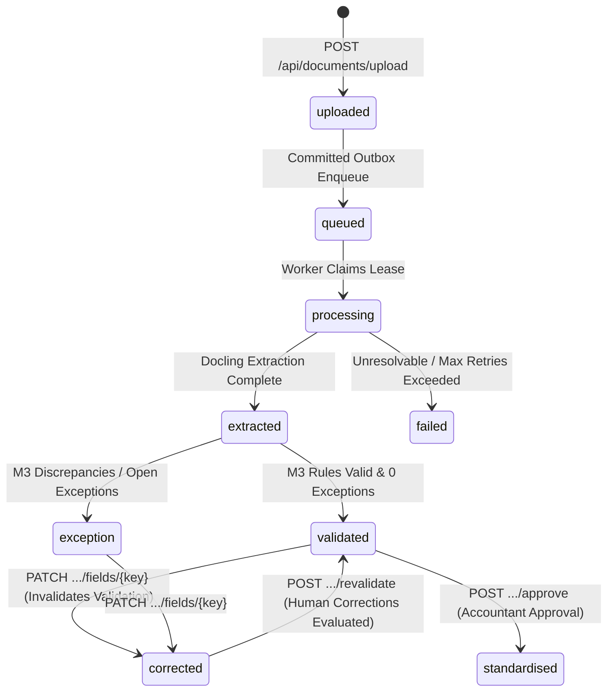

# Frontend Integration Contract & Security Architecture

**COS40005 Accounting Intelligence — Group 14**<br>
**Document Pipeline, Verification Contracts & Session Cookie Architecture**

---

## 1. Security Architecture & Same-Origin Strategy

The Accounting Intelligence platform employs defense-in-depth security for all API communications between the web frontend (Next.js / React) and the backend (FastAPI).

### 1.1 Same-Origin / Reverse Proxy Architecture

The authentication system utilizes hardened HTTP-only cookies:
- **`ai_access`**: Short-lived (15 minutes) signed JWT containing `sub` (user UUID) and `jti` (session UUID) (`Path=/api`).
- **`ai_session`**: Session identifier (`Path=/api`).
- **`ai_refresh`**: Rotating refresh token (`Path=/api/auth`).
- **`ai_mfa`**: Temporary challenge cookie during multi-factor authentication (`Path=/api/auth`).

All cookies are issued with:
```http
Set-Cookie: ai_access=...; HttpOnly; SameSite=Strict; Path=/api; Secure (production)
```

> [!IMPORTANT]
> Because `SameSite=Strict` prohibits cookies from being attached to cross-site requests or cross-port requests (e.g. from frontend `http://localhost:3000` directly to backend `http://localhost:8000`), the Next.js frontend MUST communicate with the backend via a same-origin reverse proxy or Next.js route rewrite.

#### 1.1.1 Next.js Rewrite Configuration (`next.config.js` / `next.config.mjs`)

In `next.config.mjs` (or `next.config.js`):
```javascript
/** @type {import('next').NextConfig} */
const nextConfig = {
  async rewrites() {
    return [
      {
        source: '/api/:path*',
        destination: `${process.env.BACKEND_API_URL || 'http://127.0.0.1:8000'}/api/:path*`,
      },
    ];
  },
};

export default nextConfig;
```

#### 1.1.2 Client-Side Browser Fetching Pattern
When fetching from client components (`useEffect`, event handlers, React Query, SWR):
- Always use relative URLs starting with `/api/...` (e.g., `fetch('/api/documents')`).
- Set `credentials: 'same-origin'` (default in standard `fetch`) so that the browser attaches `ai_access`, `ai_session`, and `ai_mfa` cookies.
- For all state-mutating requests (`POST`, `PATCH`, `DELETE`), include `X-Requested-With: AccountingIntelligence`.

```typescript
// Example: Client-side fetch helper
export async function apiFetch<T>(endpoint: string, options: RequestInit = {}): Promise<T> {
  const method = (options.method || 'GET').toUpperCase();
  const headers = new Headers(options.headers || {});

  // Mandatory anti-CSRF header for state mutations
  if (['POST', 'PATCH', 'PUT', 'DELETE'].includes(method)) {
    headers.set('X-Requested-With', 'AccountingIntelligence');
  }

  const res = await fetch(endpoint, {
    ...options,
    headers,
    credentials: 'same-origin', // Preserves SameSite=Strict session cookies
  });

  if (!res.ok) {
    const errorBody = await res.json().catch(() => ({ detail: res.statusText }));
    throw new Error(errorBody.detail || `Request failed with status ${res.status}`);
  }

  return res.json();
}
```

#### 1.1.3 Server Components / Server Actions Pattern (App Router)
If calling backend APIs from Next.js Server Components or Server Actions on the Node.js server:
```typescript
import { cookies } from 'next/headers';

export async function serverApiFetch<T>(endpoint: string, options: RequestInit = {}): Promise<T> {
  const cookieStore = await cookies();
  const cookieHeader = cookieStore.toString();
  const backendUrl = process.env.BACKEND_API_URL || 'http://127.0.0.1:8000';

  const headers = new Headers(options.headers || {});
  if (cookieHeader) {
    headers.set('Cookie', cookieHeader);
  }
  const method = (options.method || 'GET').toUpperCase();
  if (['POST', 'PATCH', 'PUT', 'DELETE'].includes(method)) {
    headers.set('X-Requested-With', 'AccountingIntelligence');
  }

  const res = await fetch(`${backendUrl}${endpoint}`, {
    ...options,
    headers,
    cache: 'no-store',
  });

  if (!res.ok) {
    const errorBody = await res.json().catch(() => ({ detail: res.statusText }));
    throw new Error(errorBody.detail || `Server fetch failed with status ${res.status}`);
  }

  return res.json();
}
```

### 1.2 Anti-CSRF Protection & Required Headers

All state-mutating requests (`POST`, `PUT`, `DELETE`, `PATCH`) must include the custom header:
```http
X-Requested-With: AccountingIntelligence
```

Browser cross-origin security guarantees that third-party origins cannot set custom headers without prior CORS preflight authorization. The backend middleware validates this header on all mutation endpoints. Requests omitting this header receive `HTTP 403 Forbidden`.

---

## 2. Document Processing & Lifecycle State Machine



### Document Status Codes
| Status | Description |
|---|---|
| `uploaded` | File saved to private storage, metadata and pending job created atomically. |
| `queued` | Pending job dispatched to worker queue (`cpu_tasks`). |
| `processing` | Worker has leased the pending job via atomic claim token. |
| `extracted` | Docling parsed document, versioned `raw_extractions` and `field_predictions` persisted. |
| `validated` | Module 3 validation passed without blocking exceptions (`can_approve = true`). |
| `exception` | Discrepancies detected (e.g. arithmetic variance, missing required fields, unregistered vendor). |
| `corrected` | An accountant has submitted one or more human field corrections via `PATCH` (`can_approve = false` until revalidated). |
| `standardised`| Document explicitly approved; immutable canonical entry generated in `standardised_records`. |
| `failed` | Processing aborted due to corrupt PDF, lease timeout, or retry exhaustion. |

---

## 3. Authoritative API Endpoints Contract

### 3.0 Authentication & Session Management

All frontend sessions begin with authenticated cookie issuance. Due to `SameSite=Strict`, all authentication requests must be routed via the Next.js same-origin `/api/*` rewrite proxy.

#### 3.0.1 Sign-In / Login
- **Endpoint**: `POST /api/auth/login`
- **Headers**:
  - `Content-Type`: `application/json`
  - `X-Requested-With: AccountingIntelligence`
- **Request Body**:
```json
{
  "email": "accountant@example.com",
  "password": "Password123!"
}
```
- **Response — Accountant Role (MFA via Email OTP)** (`200 OK`):
  - Sets Cookie: `ai_mfa=<challenge_token>; HttpOnly; SameSite=Strict; Path=/api/auth`
```json
{
  "mfaRequired": true,
  "enrollmentRequired": false,
  "mfaMethod": "email"
}
```
- **Response — Admin Role (MFA via TOTP)** (`200 OK`):
  - Sets Cookie: `ai_mfa=<challenge_token>; HttpOnly; SameSite=Strict; Path=/api/auth`
```json
{
  "mfaRequired": true,
  "enrollmentRequired": false
}
```
- **Response — Direct Session (No MFA Challenge)** (`200 OK`):
  - Sets Cookies:
    - `ai_access=<jwt>; HttpOnly; SameSite=Strict; Path=/api; Max-Age=900`
    - `ai_session=<uuid>; HttpOnly; SameSite=Strict; Path=/api; Max-Age=86400`
    - `ai_refresh=<token>; HttpOnly; SameSite=Strict; Path=/api/auth; Max-Age=86400`
```json
{
  "id": "4bb0524c-fe87-41ac-ac8c-225ef7874d03",
  "name": "Jane Accountant",
  "email": "accountant@example.com",
  "role": "ACCOUNTANT",
  "tenantId": "TEN-1001",
  "status": "ACTIVE",
  "mustChangePassword": false,
  "invitedBy": "",
  "invitedAt": "",
  "lastLogin": "2026-10-17 05:00:00+00:00"
}
```

#### 3.0.2 Verify MFA Code
- **Endpoint**: `POST /api/auth/verify-mfa`
- **Headers**:
  - `Content-Type`: `application/json`
  - `X-Requested-With: AccountingIntelligence`
- **Cookies**: `ai_mfa` (attached automatically by browser)
- **Request Body**:
```json
{
  "code": "123456"
}
```
- **Response (`200 OK`)**:
  - Clears `ai_mfa` cookie.
  - Sets `ai_access`, `ai_session`, and `ai_refresh` cookies.
```json
{
  "id": "4bb0524c-fe87-41ac-ac8c-225ef7874d03",
  "name": "Jane Accountant",
  "email": "accountant@example.com",
  "role": "ACCOUNTANT",
  "tenantId": "TEN-1001",
  "status": "ACTIVE",
  "mustChangePassword": false,
  "invitedBy": "",
  "invitedAt": "",
  "lastLogin": "2026-10-17 05:00:00+00:00"
}
```

#### 3.0.3 Current Authenticated User (`/me`)
- **Endpoint**: `GET /api/auth/me`
- **Headers**:
  - `X-Requested-With: AccountingIntelligence`
- **Cookies**: `ai_access`
- **Response (`200 OK`)**:
```json
{
  "id": "4bb0524c-fe87-41ac-ac8c-225ef7874d03",
  "name": "Jane Accountant",
  "email": "accountant@example.com",
  "role": "ACCOUNTANT",
  "tenantId": "TEN-1001",
  "status": "ACTIVE",
  "mustChangePassword": false,
  "invitedBy": "",
  "invitedAt": "",
  "lastLogin": "2026-10-17 05:00:00+00:00"
}
```

#### 3.0.4 Refresh Session Token
- **Endpoint**: `POST /api/auth/refresh`
- **Headers**:
  - `X-Requested-With: AccountingIntelligence`
- **Cookies**: `ai_refresh`
- **Response (`200 OK`)**:
  - Issues rotated `ai_access` and `ai_refresh` cookies.
```json
{
  "success": true
}
```

#### 3.0.5 Sign-Out / Logout
- **Endpoint**: `POST /api/auth/logout`
- **Headers**:
  - `X-Requested-With: AccountingIntelligence`
- **Cookies**: `ai_refresh`, `ai_session`
- **Response (`200 OK`)**:
  - Invalidates server session in `web_sessions` table.
  - Deletes `ai_access`, `ai_session`, `ai_refresh` cookies (`Max-Age=0`).
```json
{
  "success": true
}
```

---

### 3.1 Document Upload

- **Endpoint**: `POST /api/documents/upload`
- **Authentication**: Required (`ai_access` cookie)
- **Headers**:
  - `X-Requested-With: AccountingIntelligence`
  - `Content-Type`: `multipart/form-data`, `application/pdf`, or `application/json`
  - `X-File-Name`: (optional) e.g., `SYN-001.pdf`
  - `X-Document-Kind`: `invoice` (default), `bill`, `receipt`
  - `X-Document-Category`: `accounts_payable` (default), `accounts_receivable`
- **Body Options**:
  - **Raw Binary**: Direct PDF byte stream starting with `%PDF-`
  - **Multipart Form**: Form-data with file field
  - **JSON Base64**: `{"content_base64": "...", "filename": "SYN-001.pdf", "kind": "invoice"}`
- **Response (201 Created)**:
```json
{
  "document_id": "83cf6501-0e3c-4436-a491-ab09960ed3f4",
  "document_code": "INVOICE_100010",
  "tenant_id": "cf26c675-9329-41a8-8e40-c5381af0209d",
  "original_filename": "SYN-001.pdf",
  "kind": "invoice",
  "category": "accounts_payable",
  "status": "queued",
  "file_size_bytes": 50434,
  "file_hash_sha256": "f0b658bbc6df334c14d2254d420281eb88d4b456efb77c3afff26b304fe824bb",
  "uploaded_at": "2026-10-17T04:58:50.000000+00:00",
  "pending_job": {
    "id": "0578d2c1-99dc-43a4-ace9-1fc31891f811",
    "status": "dispatched",
    "dispatch_count": 1,
    "attempt_count": 0,
    "max_attempts": 3
  }
}
```

---

### 3.2 List Documents

- **Endpoint**: `GET /api/documents`
- **Authentication**: Required (`ai_access` cookie)
- **Query Parameters**:
  - `status`: (optional) filter by `uploaded`, `queued`, `processing`, `extracted`, `validated`, `exception`, `corrected`, `standardised`, `failed`
  - `limit`: (optional, default 50, max 100)
  - `offset`: (optional, default 0)
- **Tenant Scoping**: Automatically scoped to authenticated user's company (`tenant_id`).
- **Response (200 OK)**:
```json
[
  {
    "id": "83cf6501-0e3c-4436-a491-ab09960ed3f4",
    "document_code": "INVOICE_100010",
    "original_filename": "SYN-001.pdf",
    "kind": "invoice",
    "category": "accounts_payable",
    "status": "validated",
    "file_size_bytes": 50434,
    "uploaded_at": "2026-10-17T04:58:50.000000+00:00",
    "updated_at": "2026-10-17T04:59:14.000000+00:00"
  }
]
```

---

### 3.3 Get Document Details & Status

- **Endpoint**: `GET /api/documents/{document_id}`
- **Authentication**: Required (`ai_access` cookie)
- **Tenant Scoping**: Enforced. Accessing another tenant's document returns `404 Not Found`.
- **Response (200 OK)**:
```json
{
  "id": "83cf6501-0e3c-4436-a491-ab09960ed3f4",
  "document_code": "INVOICE_100010",
  "tenant_id": "cf26c675-9329-41a8-8e40-c5381af0209d",
  "original_filename": "SYN-001.pdf",
  "kind": "invoice",
  "category": "accounts_payable",
  "status": "validated",
  "file_size_bytes": 50434,
  "file_hash_sha256": "f0b658bbc6df334c14d2254d420281eb88d4b456efb77c3afff26b304fe824bb",
  "processing_seconds": 24.17,
  "uploaded_at": "2026-10-17T04:58:50.000000+00:00",
  "processing_started_at": "2026-10-17T04:58:50.350000+00:00",
  "processing_completed_at": "2026-10-17T04:59:14.865000+00:00",
  "updated_at": "2026-10-17T04:59:14.865000+00:00",
  "pending_job": {
    "id": "0578d2c1-99dc-43a4-ace9-1fc31891f811",
    "status": "succeeded",
    "dispatch_count": 1,
    "attempt_count": 1,
    "max_attempts": 3,
    "last_error": null
  }
}
```

---

### 3.4 Download Document Binary

- **Endpoint**: `GET /api/documents/{document_id}/download`
- **Authentication**: Required (`ai_access` cookie)
- **Tenant Scoping**: Verified. Returns `404 Not Found` if not owned by the tenant.
- **Path Traversal Security**: Strict containment root verification. Path traversal returns `403 Forbidden`.
- **Cryptographic Integrity Validation (P0-E)**: Computes on-the-fly SHA-256 and validates against database `documents.file_hash_sha256`. Returns `409 Conflict` if storage modification or tampering is detected.
- **Response (200 OK)**:
  - `Content-Type`: `application/pdf`
  - `Content-Disposition`: `attachment; filename="SYN-001.pdf"`
  - Body: Binary PDF stream.

---

### 3.5 Get Extraction & Validation Result

- **Endpoint**: `GET /api/documents/{document_id}/result`
- **Authentication**: Required (`ai_access` cookie)
- **Response (200 OK)**:
```json
{
  "document_id": "83cf6501-0e3c-4436-a491-ab09960ed3f4",
  "document_code": "INVOICE_100010",
  "status": "validated",
  "review_required": true,
  "can_approve": true,
  "run_number": 1,
  "routing_decision": "parser_only",
  "fields": [
    {
      "field_key": "currency",
      "field_label": "Currency",
      "extraction_state": "resolved",
      "resolution": "extracted",
      "raw_value": "MYR",
      "normalized_value": "MYR",
      "current_value": "MYR",
      "confidence": null,
      "evidence": [
        {
          "source": "docling",
          "page": 1,
          "bbox": [100.0, 200.0, 150.0, 215.0]
        }
      ],
      "candidates": [],
      "extraction_method": "docling_explicit_mapping",
      "is_corrected": false,
      "corrected_at": null,
      "corrected_by": null
    },
    {
      "field_key": "invoice_date",
      "field_label": "Invoice Date",
      "extraction_state": "resolved",
      "resolution": "extracted",
      "raw_value": "2026-10-01",
      "normalized_value": "2026-10-01",
      "current_value": "2026-10-01",
      "confidence": null,
      "evidence": [],
      "candidates": [],
      "extraction_method": "docling_explicit_mapping",
      "is_corrected": false,
      "corrected_at": null,
      "corrected_by": null
    },
    {
      "field_key": "invoice_number",
      "field_label": "Invoice Number",
      "extraction_state": "resolved",
      "resolution": "extracted",
      "raw_value": "SYN-001",
      "normalized_value": "SYN-001",
      "current_value": "SYN-001",
      "confidence": null,
      "evidence": [],
      "candidates": [],
      "extraction_method": "docling_explicit_mapping",
      "is_corrected": false,
      "corrected_at": null,
      "corrected_by": null
    },
    {
      "field_key": "subtotal",
      "field_label": "Subtotal",
      "extraction_state": "resolved",
      "resolution": "extracted",
      "raw_value": "50.00",
      "normalized_value": "50.00",
      "current_value": "50.00",
      "confidence": null,
      "evidence": [],
      "candidates": [],
      "extraction_method": "docling_explicit_mapping",
      "is_corrected": false,
      "corrected_at": null,
      "corrected_by": null
    },
    {
      "field_key": "supplier_name",
      "field_label": "Supplier Name",
      "extraction_state": "resolved",
      "resolution": "extracted",
      "raw_value": "Example Stationery (Synthetic)",
      "normalized_value": "Example Stationery (Synthetic)",
      "current_value": "Example Stationery (Synthetic)",
      "confidence": null,
      "evidence": [],
      "candidates": [],
      "extraction_method": "docling_explicit_mapping",
      "is_corrected": false,
      "corrected_at": null,
      "corrected_by": null
    },
    {
      "field_key": "tax_amount",
      "field_label": "Tax Amount",
      "extraction_state": "resolved",
      "resolution": "extracted",
      "raw_value": "0.00",
      "normalized_value": "0.00",
      "current_value": "0.00",
      "confidence": null,
      "evidence": [],
      "candidates": [],
      "extraction_method": "docling_explicit_mapping",
      "is_corrected": false,
      "corrected_at": null,
      "corrected_by": null
    },
    {
      "field_key": "total_amount",
      "field_label": "Total Amount",
      "extraction_state": "resolved",
      "resolution": "extracted",
      "raw_value": "50.00",
      "normalized_value": "50.00",
      "current_value": "50.00",
      "confidence": null,
      "evidence": [],
      "candidates": [],
      "extraction_method": "docling_explicit_mapping",
      "is_corrected": false,
      "corrected_at": null,
      "corrected_by": null
    }
  ],
  "line_items": [
    {
      "line_number": 1,
      "description": "Notebook",
      "quantity": 2.0,
      "unit_price": 25.0,
      "amount": 50.0,
      "field_states": {},
      "evidence": {},
      "candidates": {}
    }
  ],
  "exceptions": []
}
```

> [!NOTE]
> In accordance with financial data fidelity rules (P0-04), `confidence` is reported as `null` for Docling extractions. The backend never invents synthetic confidence scores (e.g. 1.0 or 0.5) when the underlying parser did not emit them.

---

### 3.6 Submit Accountant Field Correction (P0-B)

- **Endpoint**: `PATCH /api/documents/{document_id}/fields/{field_key}`
- **Authentication**: Required (`ai_access` cookie)
- **Headers**:
  - `X-Requested-With: AccountingIntelligence`
  - `Content-Type`: `application/json`
- **Request Body**:
```json
{
  "value": "50.00"
}
```
- **Guarantees & Side Effects**:
  - Rejects with `400 Bad Request` if the document is already in `standardised` status (immutable).
  - Updates `field_predictions.current_value`, `corrected_by`, and `corrected_at`.
  - Database trigger `protect_field_predictions` prevents tampering with immutable extraction columns (`raw_value`, `extraction_state`, `page_number`, `model_name`).
  - Database trigger `log_field_correction` appends an audit row to the append-only `field_corrections` table.
  - **Invalidates Validation**: Transitions `documents.status` to `'corrected'`. This immediately disables approval (`can_approve = false`) until revalidation is executed.
- **Response (200 OK)**:
```json
{
  "success": true,
  "document_id": "83cf6501-0e3c-4436-a491-ab09960ed3f4",
  "field_key": "total_amount",
  "new_value": "50.00",
  "corrected_at": "2026-10-17T04:59:15.216000+00:00",
  "corrected_by": "cf9246ac-ea34-4fb0-8fd5-f5db90b7cc6b",
  "document_status": "corrected"
}
```

---

### 3.7 Revalidate Document

- **Endpoint**: `POST /api/documents/{document_id}/revalidate`
- **Authentication**: Required (`ai_access` cookie)
- **Headers**: `X-Requested-With: AccountingIntelligence`
- **Behavior**:
  - Reads the current extraction run (`is_current = TRUE`).
  - Evaluates business rules against the latest field values, giving full precedence to human edits (`current_value`).
  - Resolves previously opened exceptions (`status = 'resolved'`, `resolved_at = now()`) to maintain complete audit history.
  - Updates document status to `validated` (if clear) or `exception` (if unresolved discrepancies remain).
- **Response (200 OK)**:
```json
{
  "workflow_status": "M3_VALIDATION_COMPLETE",
  "validation_status": "VALID",
  "document_status": "validated",
  "exceptions_count": 0,
  "errors": []
}
```

---

### 3.8 Approve Document & Generate Standardised Record (P0-B)

- **Endpoint**: `POST /api/documents/{document_id}/approve`
- **Authentication**: Required (`ai_access` cookie)
- **Role Enforcement**: Restricted strictly to `accountant`, `local_admin`, or `super_admin`.
- **Headers**:
  - `X-Requested-With: AccountingIntelligence`
- **Precondition Verification**:
  - **Status Check**: Document status must be strictly `'validated'`. Documents in `'corrected'`, `'exception'`, or `'uploaded'` status are rejected with `400 Bad Request`.
  - **Exception Check**: Requires zero open exceptions.
  - **Duplicate Check**: If document has already been approved, returns `400 Bad Request` (`Document has already been approved as REC-...`).
  - **Mandatory Fields Check**: Enforces presence and non-empty values for:
    - `supplier_name`
    - `invoice_number`
    - `invoice_date`
    - `total_amount`
    *(Never invents or fabricates default values).*
- **Effects**:
  - Atomically creates an immutable entry in `standardised_records` containing verified header fields, line items, real ISO 8601 UTC approval timestamp, and approver user UUID.
  - Transitions `documents.status` to `standardised`.
  - Writes an audit log entry to `audit_logs` (`action = 'APPROVE_DOCUMENT'`).
- **Response (200 OK)**:
```json
{
  "success": true,
  "document_id": "83cf6501-0e3c-4436-a491-ab09960ed3f4",
  "document_code": "INVOICE_100010",
  "document_status": "standardised",
  "standardised_record_id": "399d1c7e-5db9-4af4-940d-17c4ba1ba2cf",
  "record_code": "REC-10004",
  "approved_by": "4bb0524c-fe87-41ac-ac8c-225ef7874d03",
  "approved_at": "2026-10-17T04:59:15.808904+00:00"
}
```

---

## 4. Rerun Carry-Forward Policy (`switch_current_extraction`)

When a document undergoes re-extraction (e.g. reprocessing with updated model parameters or re-queuing):
1. A new `raw_extractions` record is created with `run_number = max(run_number) + 1` and `is_current = FALSE`.
2. Fresh parser extraction predictions are written to `field_predictions` for the new `extraction_id`.
3. The stored function `SELECT switch_current_extraction(new_extraction_id)` is invoked:
   - Deactivates previous runs (`is_current = FALSE`).
   - Sets `new_extraction.is_current = TRUE`.
   - Atomically carries forward all human corrections (`current_value`, `corrected_by`, `corrected_at`) where human edits were present in previous runs.
4. No accountant work is lost during re-extractions.
